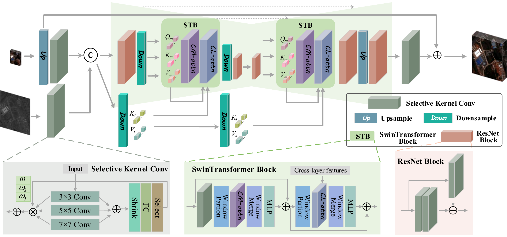
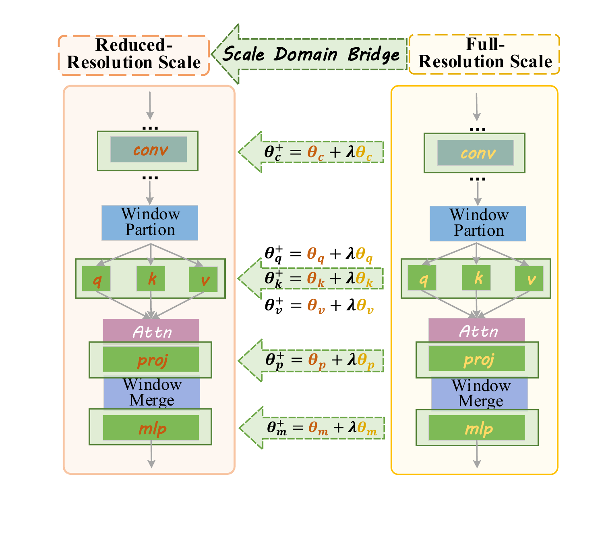

# CS2P: Cross-Scale Learning for Spectral Pansharpening

**Meiqi Gong, Hao Zhang, Yuxin Deng, Linfeng Tang, and Jiayi Ma** 
Electronic Information School, Wuhan University

CS2P is a cross-scale learning framework for **multispectral and hyperspectral pansharpening**. It addresses the scale domain gap that arises when a model trained at the reduced-resolution scale (RRS) is applied at the full-resolution scale (FRS), aiming to improve full-resolution performance while preserving reduced-resolution reconstruction quality.

## Overview

CS2P addresses cross-scale generalization through two complementary designs:

- **Global Scale-Adaptive Network (GSAN):** combines Transformer attention and selective kernel convolution to capture long-range dependencies and adapt receptive fields to image content across scales.
- **Scale Domain Bridge (SDB):** progressively injects full-resolution information into the reduced-resolution model through learnable parameter connections, guided by a domain-adaptive loss weight.

The method is evaluated on three multispectral datasets (**QB, GF2, and WV2**) and two hyperspectral datasets (**Chikusei and ColonCancer**).

## Network Architecture

  

*Overall architecture of GSAN and its building blocks.*

GSAN extracts shallow features from the spectral and PAN inputs using **selective kernel convolution (SKConv)**, then concatenates them and feeds them into a U-Net structure with ResNet and SwinTransformer blocks. SKConv adaptively combines **3 x 3, 5 x 5, and 7 x 7** convolutional kernels. Within the Transformer blocks, **cross-modality attention (CM-attn)** exchanges information across modalities, while **cross-layer attention (CL-attn)** incorporates shallow features into deeper representations. The network predicts a residual that is added to the upsampled spectral input to reconstruct the high-resolution output.

## Scale Domain Bridge (SDB)

  

*SDB connects corresponding linear layers of the separately pretrained RRS and FRS models.*

SDB transfers information from the full-resolution model into the reduced-resolution model through a learnable additive connection. For the i-th linear layer:

$$
\theta_{R,i}^{+} = \theta_{R,i} + \lambda_i\,\theta_{F,i}, \qquad i = 1,\ldots,N.
$$

Here, $\theta_{R,i}$ and $\theta_{F,i}$ are the corresponding RRS and FRS parameters. The learnable injection coefficient $\lambda_i$ is **initialized to zero**, so the bridged model starts from the pretrained RRS model and progressively incorporates full-resolution information. SDB is applied to convolutional layers and the query, key, value, output projection, and MLP layers in the Transformer blocks.

Training consists of two stages:

1. **Independent pretraining:** train the RRS and FRS models separately. RRS uses supervised L1 reconstruction loss. FRS uses a QNR-based loss for real-world multispectral pansharpening, or supervised L1 loss when full-resolution ground truth is available in the synthetic hyperspectral setting.
2. **SDB optimization:** initialize the bridged model from the RRS model, freeze its nonlinear layers, and optimize its linear-layer parameters and injection coefficients using both scales:

$$
\mathcal{L}_{\mathrm{SDB}} = \alpha\,\mathcal{L}_{\mathrm{RRS}} + (1-\alpha)\,\mathcal{L}_{\mathrm{FRS}}.
$$

The **domain-adaptive weight (DAW)** $\alpha\in[0,1]$ is computed at each iteration using the multiple-gradient descent algorithm (MGDA), balancing the two scale objectives during SDB optimization.

## Training Time

Training time cost of CS2P on five datasets. Per-epoch times are measured on a **single NVIDIA A800 80GB PCIe GPU**. Total training time assumes **parallel RRS and FRS pretraining on two GPUs, followed by SDB training**.

<table>
  <thead>
    <tr>
      <th rowspan="2">Dataset</th>
      <th colspan="2">RRS training</th>
      <th colspan="2">FRS training</th>
      <th colspan="2">SDB training</th>
      <th rowspan="2">Total time (h)</th>
    </tr>
    <tr>
      <th>Epochs</th><th>min/epoch</th>
      <th>Epochs</th><th>min/epoch</th>
      <th>Epochs</th><th>min/epoch</th>
    </tr>
  </thead>
  <tbody>
    <tr><td>QB</td><td>32</td><td>21</td><td>4</td><td>37</td><td>2</td><td>42</td><td>12.6</td></tr>
    <tr><td>GF2</td><td>40</td><td>21</td><td>5</td><td>37</td><td>5</td><td>42</td><td>17.5</td></tr>
    <tr><td>WV2</td><td>40</td><td>25</td><td>13</td><td>62</td><td>10</td><td>114</td><td>35.7</td></tr>
    <tr><td>Chikusei</td><td>35</td><td>38</td><td>15</td><td>71</td><td>10</td><td>115</td><td>41.3</td></tr>
    <tr><td>ColonCancer</td><td>26</td><td>115</td><td>10</td><td>177</td><td>8</td><td>180</td><td>73.8</td></tr>
  </tbody>
</table>

The total wall-clock time is calculated as:

$$
T_{\mathrm{total}} = \frac{\max(E_R t_R,\ E_F t_F) + E_S t_S}{60},
$$

where $E_R$, $E_F$, and $E_S$ are the numbers of epochs for RRS, FRS, and SDB training, respectively, and $t_R$, $t_F$, and $t_S$ are their per-epoch times in minutes. Totals are rounded to one decimal place. The epoch counts report the validation-selected stopping points rather than the maximum training limits.

## Code Availability

The code will be released after the review decision.
